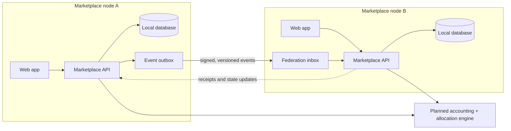

<div align="center">

# Open Market Protocol

### Markets without gatekeepers.

Open-source infrastructure for independently operated, interoperable marketplaces.

**Open infrastructure · Competitive markets · Shared prosperity**

[Why it matters](#why-it-matters) · [Architecture](#how-it-fits-together) · [Roadmap](#road-to-v01-alpha) · [Contribute](#help-build-the-foundation)

</div>

> [!IMPORTANT]
> **Pre-alpha / design stage.** This repository currently contains project documentation, not a working implementation. There is no deployed service, usable demo, published package, or verified quickstart yet.

## One market, many operators

Open Market Protocol (OMP) explores a shared layer for digital marketplaces that can cooperate without surrendering their data, identity, or commercial autonomy to one platform owner.

An OMP marketplace node is intended to run independently: it manages its own members, listings, transactions, policies, and database. Nodes exchange signed marketplace events so a customer on one node can discover and transact with a supplier on another. A transparent accounting layer is planned to make fees and simulated surplus allocations inspectable and reproducible.

The first goal is deliberately narrow: **two independent marketplace nodes completing a simulated cross-node booking, with the economic trail visible end to end.**

## Why it matters

Most marketplace infrastructure bundles discovery, identity, rules, data, and payments inside a single company. That is convenient, but it concentrates power and makes participants dependent on one gatekeeper.

OMP takes a different direction:

| Centralised platform | Open Market Protocol direction |
| --- | --- |
| One operator controls the network | Independent operators can run compatible nodes |
| Participant data is held in one system | Each node owns and governs its local data |
| Rules and fees can be opaque | Versioned rules and inspectable fee calculations |
| Leaving may mean losing reputation or reach | Portability and adapters are roadmap goals |
| Network value accrues to the platform | Economic allocation can be explicit and governed |
| A central outage can stop the whole market | Local operation should continue during remote outages |

This is a design intent, not a claim that these properties have been implemented or validated.

## How it fits together



Each node remains an operational boundary. Federation transport, event contracts, booking state, and accounting rules must be documented well enough for an independent implementation to interoperate.

Read the [architecture outline](docs/architecture.md) for boundaries, proposed technology choices, security considerations, and open decisions.

## Alpha demo

The proposed v0.1 alpha will demonstrate:

- two independently configured nodes with separate databases and signing keys;
- listings shared across node boundaries;
- a fictional cross-node booking and complete state history;
- retries and idempotency without duplicate bookings;
- transparent, simulated fees and surplus allocation;
- a federation inspector showing messages exchanged between nodes.

**No demo is deployed today. No real payments, dividends, ownership rights, or financial entitlements are planned for the alpha.**

### Product preview

<table>
<tr>
<td width="50%" align="center"><strong>Marketplace discovery</strong><br><br><em>Screenshot planned</em><br>Browse local and federated listings.</td>
<td width="50%" align="center"><strong>Federation inspector</strong><br><br><em>Screenshot planned</em><br>Follow a booking across two nodes.</td>
</tr>
<tr>
<td width="50%" align="center"><strong>Operator console</strong><br><br><em>Screenshot planned</em><br>Manage listings, bookings, and node settings.</td>
<td width="50%" align="center"><strong>Economic report</strong><br><br><em>Screenshot planned</em><br>Inspect fees and simulated allocations.</td>
</tr>
</table>

These are placeholders for interfaces that have not yet been built.

## Quickstart — planned

A reproducible quickstart is a v0.1 acceptance requirement, but **the commands do not exist yet**. The intended experience is:

```text
# Planned workflow — not currently runnable
clone repository
start two isolated nodes with Docker Compose
open the local demo
complete a simulated federated booking
inspect the event and accounting trail
```

This section will be replaced with verified commands only after a fresh clone can launch the system and its automated checks pass.

## Road to v0.1 alpha

| Phase | Outcome | Status |
| --- | --- | --- |
| **0 · Foundation** | Repository structure, decisions, licence, contribution rules, CI | Documentation started |
| **1 · Standalone node** | Listings, accounts, booking simulation, operator UI | Planned |
| **2 · Federation** | Discovery and cross-node booking between independent servers | Planned |
| **3 · Distributed economics** | Double-entry ledger, transparent fees, simulated allocations | Planned |
| **4 · Public alpha** | Hosted demo, two-node self-hosting, tests, public documentation | Planned |

No dates are promised. The sequence and exit criteria live in the [v0.1 roadmap](docs/roadmap.md).

## Proposed architecture and stack

The current technical direction is subject to architecture decisions and prototyping:

| Layer | Proposed direction |
| --- | --- |
| Language | TypeScript |
| Web application | React + Vite |
| Node API | Fastify |
| Persistence | PostgreSQL with migrations |
| Federation | Fedify and applicable marketplace federation patterns |
| Local orchestration | Docker Compose |
| Contracts | Versioned schemas, OpenAPI where appropriate |
| Quality | Unit, integration, conformance, and end-to-end tests |
| Delivery | GitHub Actions |

Technology choices are proposals, not installed dependencies. See [architecture.md](docs/architecture.md) before treating them as commitments.

## Principles

1. **Protocol before implementation.** Public contracts should not expose framework or database internals.
2. **Independent operation.** A node must not depend on infrastructure controlled by the project founders.
3. **Local ownership.** Operators retain control of local membership, policy, and data.
4. **Transparent economics.** Fees and allocations should be versioned, reproducible, and auditable.
5. **Secure defaults.** Authentication, signing, replay protection, SSRF defence, and key handling are core design work.
6. **Interoperability by evidence.** A second implementation is the real test of an open protocol.
7. **No real money in alpha.** Early transactions and allocations are simulations only.
8. **Honest documentation.** Planned capabilities stay labelled as planned until demonstrated.

## Help build the foundation

The most useful contributions right now are design review and small, explicit foundation work:

- challenge the federation, security, and accounting assumptions;
- propose architecture decision records and protocol schemas;
- help define booking state transitions and failure cases;
- turn roadmap outcomes into focused issues with acceptance criteria;
- improve accessibility, documentation, and contributor onboarding;
- bring experience from cooperatives, marketplaces, distributed systems, or economic governance.

Start with [CONTRIBUTING.md](CONTRIBUTING.md), then read the [architecture](docs/architecture.md) and [roadmap](docs/roadmap.md). Please open an issue before a large implementation so the project can agree on boundaries first.

## Documentation

- [Roadmap and phase exit criteria](docs/roadmap.md)
- [Architecture and open decisions](docs/architecture.md)
- [Contributing guide](CONTRIBUTING.md)
- [GitHub Pages plan](docs/github-pages.md)

---

<div align="center">

**Open infrastructure. Competitive markets. Shared prosperity.**

Pre-alpha research and development — participation is welcome, certainty is not implied.

</div>
