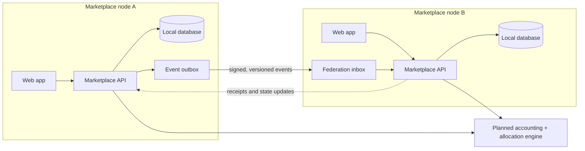

<div align="center">

# Open Market Protocol

### Markets without gatekeepers.

Open-source infrastructure for independently operated, interoperable marketplaces.

**Open infrastructure · Competitive markets · Shared prosperity**

[Why it matters](#why-it-matters) · [Architecture](#how-it-fits-together) · [Roadmap](#road-to-v01-alpha) · [Contribute](#help-build-the-foundation)

</div>

> [!IMPORTANT]
> **Pre-alpha / Phase 1 single-node demo.** This branch implements a local marketplace simulation with fictional listings, accounts, bookings, and state history. It is not deployed, federated, production-ready, or connected to payments.

## One market, many operators

Open Market Protocol (OMP) explores a shared layer for digital marketplaces that can cooperate without surrendering their data, identity, or commercial autonomy to one platform owner.

An OMP marketplace node is intended to run independently: it manages its own members, listings, transactions, policies, and database. Nodes exchange signed marketplace events so a customer on one node can discover and transact with a supplier on another. A transparent accounting layer is planned to make fees and simulated surplus allocations inspectable and reproducible.

The first goal is deliberately narrow: **two independent marketplace nodes completing a simulated cross-node booking, with the economic trail visible end to end.**

## Why it matters

Most marketplace infrastructure bundles discovery, identity, rules, data, and payments inside a single company. That is convenient, but it concentrates power and makes participants dependent on one gatekeeper.

OMP takes a different direction:

| Centralised platform | Open Market Protocol direction |
| --- | --- |
| One operator controls the network | Independent operators can run compatible nodes |
| Participant data is held in one system | Each node owns and governs its local data |
| Rules and fees can be opaque | Versioned rules and inspectable fee calculations |
| Leaving may mean losing reputation or reach | Portability and adapters are roadmap goals |
| Network value accrues to the platform | Economic allocation can be explicit and governed |
| A central outage can stop the whole market | Local operation should continue during remote outages |

This is a design intent, not a claim that these properties have been implemented or validated.

### A stronger deal for every side

| Participant | Rational reason to join |
| --- | --- |
| Consumer | Broader choice, captured terms, visible history, and a credible path to portability |
| Supplier | Reach demand on other nodes without surrendering the local customer relationship |
| Operator | Grow the effective catalogue and demand pool without selling or centralising the market |
| Contributor | Build against a neutral, testable protocol rather than a privileged intermediary |

The network works only if cooperation is individually rational and useful without permanent subsidies. Read the [participation and incentive design](docs/economic-design.md) for the game-theoretic constraints, bootstrapping strategy, consumer metrics, and falsifiable adoption test.

## How it fits together



Each node remains an operational boundary. Federation transport, event contracts, booking state, and accounting rules must be documented well enough for an independent implementation to interoperate.

Read the [architecture outline](docs/architecture.md) for boundaries, proposed technology choices, security considerations, and open decisions.

## Alpha demo

The proposed v0.1 alpha will demonstrate:

- two independently configured nodes with separate databases and signing keys;
- listings shared across node boundaries;
- a fictional cross-node booking and complete state history;
- retries and idempotency without duplicate bookings;
- transparent, simulated fees and surplus allocation;
- a federation inspector showing messages exchanged between nodes.

**No demo is deployed today. No real payments, dividends, ownership rights, or financial entitlements are planned for the alpha.**

### What works in this branch

- three fictional service listings loaded from PostgreSQL;
- participant account creation;
- booking proposal with the listing price captured at creation;
- confirm, complete, and cancel actions;
- deterministic transition rules and append-only event history;
- responsive browser UI and database-backed API;
- CI integration coverage for the complete successful path and invalid terminal transitions.

Federation, distributed accounting, operator listing management, real authentication, and a hosted URL remain planned.

## Run the single-node demo

Requirements: Node.js 22, npm, Docker, and Docker Compose.

```bash
npm ci
docker compose up -d postgres
npm run db:migrate
```

Run the API and web application in separate terminals:

```bash
npm run dev:api
npm run dev:web
```

Open `http://localhost:5173`. The API is available on `http://127.0.0.1:3000`, and `GET /health` reports database readiness.

All displayed identities, services, prices, and bookings are fictional. The application does not collect payment or create a real service agreement.

A two-node marketplace quickstart remains a later acceptance requirement and is **not currently available**.

## Road to v0.1 alpha

| Phase | Outcome | Status |
| --- | --- | --- |
| **0 · Foundation** | Repository structure, decisions, licence, contribution rules, CI | In progress |
| **1 · Standalone node** | Listings, accounts, booking simulation, web UI | Implemented on review branch; CI verified |
| **2 · Federation** | Discovery and cross-node booking between independent servers | Planned |
| **3 · Distributed economics** | Double-entry ledger, transparent fees, simulated allocations | Planned |
| **4 · Public alpha** | Hosted demo, two-node self-hosting, tests, public documentation | Planned |

No dates are promised. The sequence and exit criteria live in the [v0.1 roadmap](docs/roadmap.md).

## Architecture and stack

The initial workspace now uses:

| Layer | Current direction |
| --- | --- |
| Language | TypeScript |
| Web application | React + Vite single-node marketplace UI |
| Node API | Fastify health and marketplace endpoints |
| Persistence | PostgreSQL migrations, listings, accounts, bookings, and event history |
| Federation | Fedify and applicable marketplace federation patterns under evaluation |
| Local orchestration | Docker Compose |
| Contracts | Zod schemas for nodes, listings, accounts, bookings, and state transitions |
| Quality | Formatting, linting, unit and PostgreSQL integration tests, production builds |
| Delivery | GitHub Actions verification |

See [ADR 0001](docs/adr/0001-reference-stack.md) and [architecture.md](docs/architecture.md). The standalone marketplace and persistence path exists. Federation and distributed accounting do not.

## Principles

1. **Protocol before implementation.** Public contracts should not expose framework or database internals.
2. **Independent operation.** A node must not depend on infrastructure controlled by the project founders.
3. **Local ownership.** Operators retain control of local membership, policy, and data.
4. **Transparent economics.** Fees and allocations should be versioned, reproducible, and auditable.
5. **Secure defaults.** Authentication, signing, replay protection, SSRF defence, and key handling are core design work.
6. **Interoperability by evidence.** A second implementation is the real test of an open protocol.
7. **No real money in alpha.** Early transactions and allocations are simulations only.
8. **Honest documentation.** Planned capabilities stay labelled as planned until demonstrated.

## Help build the protocol

The most useful contributions right now are design review and small, explicit foundation work:

- challenge the federation, security, and accounting assumptions;
- propose architecture decision records and protocol schemas;
- help define booking state transitions and failure cases;
- turn roadmap outcomes into focused issues with acceptance criteria;
- improve accessibility, documentation, and contributor onboarding;
- bring experience from cooperatives, marketplaces, distributed systems, or economic governance.

Start with [CONTRIBUTING.md](CONTRIBUTING.md), then read the [architecture](docs/architecture.md) and [roadmap](docs/roadmap.md). Please open an issue before a large implementation so the project can agree on boundaries first.

## Documentation

- [Roadmap and phase exit criteria](docs/roadmap.md)
- [Architecture and open decisions](docs/architecture.md)
- [Reference stack decision](docs/adr/0001-reference-stack.md)
- [Participation and incentive design](docs/economic-design.md)
- [Contributing guide](CONTRIBUTING.md)
- [GitHub Pages plan](docs/github-pages.md)

---

<div align="center">

**Open infrastructure. Competitive markets. Shared prosperity.**

Pre-alpha research and development — participation is welcome, certainty is not implied.

</div>
